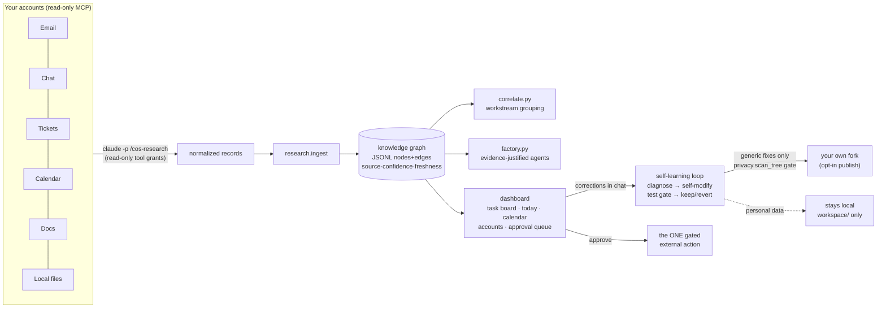

# AI OS — Chief-of-Staff Agent System

An installable, self-contained AI operating layer for your work. Run one install command,
answer nothing, and it feels like hiring a chief of staff on day one:

1. **Give it context (optional).** On first launch the dashboard asks — paste text or attach
   files (md/txt/pdf/docx: resume, project docs, notes). Skip if you'd rather it figure things
   out itself.
2. **It researches you.** `/cos-research` crawls your connected accounts (email, messages,
   tickets, calendar, docs, repos, local projects) and builds a **knowledge graph**: every fact
   with source, confidence, freshness, deduped by construction. Connector access is read-only
   because the research grant contains no mutating connector tool (see Security below for what
   the grant does contain). Connector content is sent to the model provider for extraction, so
   "local-first" describes where state is stored, not where text is processed.
3. **It discovers your workspaces.** Employer, freelance clients, personal projects, job
   search, school. Workspace assignment at research time is model judgment, not an enforced
   wall; grant-level isolation applies to the per-workspace comms agents the factory generates
   (`dashboard/factory.py`). Measured on the eval set: the baseline instructions leaked across
   workspaces in 1 of 18 held-out stories; the revised instructions leaked in 0 (see evals/).
4. **It creates only the agents your work justifies.** A ticketing cluster earns an
   investigator; job-search entities earn a Job Search agent; personal repos earn a Project
   Builder — each with a full spec and read/draft-only tools.
5. **It populates the dashboard.** A LinkedIn-style task board (its own to-dos, extracted from
   your real obligations), Today summary, calendar, workstream cards, accounts panel.
6. **It keeps learning forever.** Polling re-researches changed sources; tell the chat
   "you're missing the email from X" and the **self-learning loop** fetches it, reasons about
   *why* it was missed, fixes the cause (config, instructions, or its own code — test-gated
   with automatic rollback), records the lesson, and can publish the generic fix to your own
   fork through a privacy gate (`dashboard/privacy.py`, opt-in; see Security below for exactly
   what it checks and what it cannot see).

**The line it never crosses:** agents read, research, analyze, and draft autonomously — but
every external action (send, post, ticket change, calendar change, merge, deploy) goes to an
**approval queue** for you. The only thing the system ever asks unprompted is connector
authorization, via a dashboard popup you can refuse permanently.

## Install

```bash
curl -fsSL https://raw.githubusercontent.com/YOUR-USERNAME/YOUR-FORK/main/install.sh \
  | bash -s -- --repo https://github.com/YOUR-USERNAME/YOUR-FORK.git --start
```

Or from a checkout: `./install.sh --start`. Requirements: Python ≥ 3.12, the
[`claude` CLI](https://claude.ai/install.sh), macOS or Linux. Then, in Claude Code from the
install folder, run `/global:setup` once. Dashboard: `http://127.0.0.1:8765`. Remove cleanly
anytime with `/cos-uninstall`.

## Bring your own model

Every job has a level, and you pick the model for each level in **Settings → Models** on the
dashboard (stored in `dashboard/models.json`):

| Level | Jobs | Good default |
|---|---|---|
| Light | quick chat replies, task chat, account checks | a small fast model (Haiku, GPT mini, Gemini Flash) |
| Standard | drafts, revisions, the regular polls | a mid model (Sonnet) |
| Deep | the first full research crawl, learning from corrections | the strongest model you have (Opus, Fable) |

Each level runs on one of:
- **Your Claude subscription** through Claude Code. This is the default and needs no key; it just
  passes `--model`.
- **Your own API key** for Anthropic (`pip install anthropic`), OpenAI or Gemini.
- **OpenRouter**, one key for many models.
- **A local Ollama model**, free.

The instructions are the same whichever model runs them. Keys stay on your machine in
`dashboard/secrets.json` (mode 0600, git-ignored, excluded from publishing, and blocked by the
privacy scan) and go only to their provider.

Jobs that read your accounts through Claude Code's connectors (the first research crawl,
learning, approvals) run on Claude Code. When their level names another provider they use
Claude Code's default model, and Settings says so. The daily check does not need Claude Code
at all if you add direct connections (below). The evals back the defaults: a small model
on the first crawl or on the weekly polls missed tasks the default model caught
([long-run report](./evals/results/longrun/REPORT.md)), so keep Standard and Deep strong.

## Daily checks without Claude Code

**Settings → Accounts → Direct connections** reads your accounts directly, read-only:

| connection | what you give it |
|---|---|
| any mailbox over IMAP | an app password |
| Slack | a user token |
| Jira Cloud | an API token |
| GitHub | a personal access token |
| calendar | its private iCal link |
| folders on this computer | nothing: pick the folders (Zoom's Documents/Zoom, Downloads, a project) |
| Zoom cloud recordings | a Server-to-Server OAuth app with read-only recording access |

Each check runs in three steps (`dashboard/poll_direct.py`):

1. **Fetch only what is new.** Every connection keeps a bookmark: the last mail UID, the newest Slack message per conversation, "updated since" for Jira and GitHub, the last change for the calendar, each file's modified time in a watched folder, and the Zoom meetings already read. A meeting transcript (Zoom, Teams, Meet, Otter; .vtt, .srt, .txt or .docx) is cleaned to who said what without a model, which roughly halves it.
2. **Sift without a model** (`dashboard/sift.py`). It keeps what could need you: direct messages, mentions, your threads, your tickets and reviews, mail to everyone that says it is required, platform notices with a person's words in them, anything naming one of your open tasks' tickets, PRs, invoices or domains, and your own files. Newsletters, bots, other people's tickets and channel chatter are dropped and counted. If nothing is left, the check stops there and costs nothing.
3. **One text-only model call** on what is left, one compact line per item, together with your open tasks. It runs on whatever model you chose for Standard: your Claude plan or any API key. A one-off call skips prompt caching, which would cost more than it saves.

Measured on the four weekly checks of the 142,555-item benchmark world (`evals/results/longrun/REPORT.md`):

| weekly checks | dev | test | cost of the four | time per check |
|---|---|---|---|---|
| the agent searches all ~8,200 new items with tools | 44/50 | 48/50 | $3.43 | ~110 s |
| sifted to ~480 items, the agent searches them | 46/50 | 48/50 | $2.20 | ~40 s |
| sifted, one call with the items inline, no tools | 46/50 | 48/50 | $1.54 | ~17 s |
| the same, one compact line per item, no caching premium (the default) | 46/50 | 48/50 | $0.52 | ~16 s |

4. **A drafted next step for each new task** (one more text-only call, only when there are new tasks): the reply to the person who asked, or the work itself (an outline with the points from the meeting, the steps). They wait in the approval queue; nothing is sent until you approve it.

**Always on, and free until something matters.** Steps 1 and 2 run every 5 minutes, all day, across every connection: mail, Slack, Jira, GitHub, calendar, your folders and Zoom. They cost nothing. What the sift keeps waits on a list (`pending.jsonl`) and is read in one batch three times a day (about 8am, noon and 4pm), because every call has a fixed cost however few items it carries. Something urgent skips the wait and is read at once: a meeting transcript, a security alert, or a message to you that asks for something today. Measured daily for four weeks on the benchmark world: dev 46/50, test 47/50, $1.15 for 28 batches. Change the hours under Polling, or press Check now to read everything waiting.

Example, run live: a 22-turn Zoom call saved to Documents/Zoom was picked up by the next scan and read at once (urgent). It produced the meeting and three tasks for the user with the dates said aloud (final pricing copy by Wednesday, a webinar deck by Monday, an email to a customer today), left out what a colleague took on, and queued three drafts: the customer email, the deck outline with the four topics from the call, and the steps to finish the copy. Two calls, 24 seconds, $0.05. A scan with nothing new took 0.09 seconds and made no call.

Credentials stay in `connections.json` (mode 0600, git-ignored, excluded from publishing, and Slack, GitHub and Atlassian tokens are blocked by the privacy scan).

## What it costs

Every model call reports its own cost, and **Settings → Usage** shows it by day, job and
model. The usage limiter (`dashboard/usage.py`) keeps the cost down:

- **Only the tools a job may use are sent.** Claude Code otherwise sends every built-in
  tool's definition with each call, about 40k tokens. Measured on the same small job:
  $0.075 before, $0.042 after; on a bare reply, $0.057 before, $0.007 after.
- **Every call has a ceiling** (`--max-budget-usd`, per job), so a runaway job stops.
- **A daily budget** (optional) pauses scheduled polls and new model jobs for the rest of
  the day. Actions you approve still go through.
- **Quiet connectors are checked less often:** after 3 polls that found nothing new, a
  connector waits twice its interval, and after 6, four times. It returns to normal as soon
  as something turns up. The deep "general" sweep keeps its pace.
- **Effort per level** (how hard the model thinks) is a setting in Models. It is off by
  default because its effect on quality has not been measured yet.

## Architecture



Everything is file-based and stdlib-only (no database, no dependencies): auditable with
`cat`, portable with `cp`, versioned with `git`.

## Works with whatever you have

| Connected | What you get |
|---|---|
| Nothing | Dashboard, task inbox, chat, approval queue |
| Email only | Obligation extraction (the to-do board), deadline tracking, blocked-work detection |
| + Calendar | Today brief, meeting cards, calendar dots, schedule-aware ranking |
| + Docs/Drive | Project discovery, document trails in workstreams |
| + Tickets (Jira/Asana/Linear) | Investigations, ticket-aware workstreams, per-system agents |
| + Chat (Slack) | Channel activity, people graph, cross-surface dedupe |
| + A second account of anything | Separate instance, own login, own workspace; comms agents hold only their own account's read tools |

Connector outages degrade gracefully: the preflight reports what's unreachable and research
continues with what works.

## Measured, not vibes

`evals/` holds an agent evaluation harness for the one LLM step in the pipeline. The dataset
is 36 hand-authored base stories, each in three cast rotations (108 fixtures), with 18 base
stories held out as test; 12 behavior categories including prompt injection and workspace
isolation. The extraction step runs headless against fixtures with zero MCP servers mounted,
outputs flow through the real ingest, graph, and correlate path, and runs are compared at the
story level (cluster bootstrap and an exact paired permutation test; cast rotations of one
story count as one piece of evidence). On the held-out stories the revised extraction
contract improved F1 from 0.835 to 0.932 and a small-model configuration scored 1.000 at
about one sixth of the default model's cost, but no pairwise comparison reaches p < 0.05 at
the story level with 18 stories, and the eval's injection evidence is one held-out injection
story with one technique. A source-support checker verifies that cited sources actually
state the obligation, the due date, and the counterparty, with its own hand-audited
agreement rate. Full numbers, matching rules, label-correction log, and the story-level
re-analysis that replaced earlier overconfident fixture-level p values are in
[`evals/README.md`](./evals/README.md) and `evals/results/`. Unit suites, from actual runs:
234 tests in `dashboard/tests/` plus 51 in `evals/tests/`, CI on Python 3.9 and 3.12.

## The Kestrel benchmark

A whole made-up person's accounts, built from code: Dana Kowalski, an engineer who also
freelances on Upwork, is job hunting and has side projects. 142,555 items over four months
(109,554 before the first read): Slack, four Gmail inboxes, Jira, GitHub, Calendar and Drive,
with spam, phishing, receipts and family mail mixed in. 101 tasks have written answers, in
matched halves for tuning and for reporting. Score any agent with one command, write your own
tasks, or fine-tune on the tuning half. See [`evals/longrun/BENCHMARK.md`](./evals/longrun/BENCHMARK.md).

## Security & privacy posture

Each claim below names what enforces it, what it covers, and what it does not.

- **Subprocess tool grants** (`dashboard/server.py`, `--allowedTools` under
  `--permission-mode dontAsk`; shipped defaults pinned by `tests/test_grants.py`):
  chat holds `Read,Agent` plus read-only connector tools; poll holds `Read,Edit,Agent`;
  research and the account probe hold `Read,Glob,Grep,Agent,ToolSearch`, file writes only
  inside the workspace (`Edit(//<workspace>/**)`), and Bash only for `dashboard/cos_tool.py`
  (`dashboard/grants.py`), plus the read-only connector tools `/setup` discovers.
  `cos_tool.py` is a fixed list of graph and account operations that take JSON files and
  run no code from them. No subprocess holds a mutating connector tool, unscoped Bash or
  WebSearch. History: an outside review on 2026-10-05 found unscoped Bash in the research
  default; an audit on 2026-10-27 pointed out that the narrowed `Bash(python3:*)` was still a
  whole interpreter that a crawl steered by a malicious message could use to read any file
  or reach the network. An old config's broad entries are now ignored. Not covered: a
  deployment owner can widen their own grants (`research_broad_grant: true`, or the learn
  job's `learn_tools`, which keeps `Bash(python3:*)` and `Bash(git:*)` because it runs the
  test suite; it starts only when the user reports a miss in chat, and since 2026-10-27 it
  changes code only when `self_modify_code` is turned on, otherwise drafting the change as a
  task); `validate_config.py` warns. Not a sandbox: the processes run as the user.
- **Prompt injection**: injected text cannot trigger an external action, because the
  subprocess reading it holds no tool that sends or posts. Injected text CAN still shape
  what gets written locally: records, to-dos, drafts, and approval-queue proposals. The
  approval queue is the backstop, and the human clicking approve is part of the security
  model. Eval coverage so far: one held-out injection story (one technique), resisted at
  the record level in all four runs; the eval runner itself uses `Read,Glob` only, so eval
  results do not exercise the production grant.
- **One execution path**: only `/cos-approve` holds mutating grants, only against the exact
  stored `proposed_tool_call`, only after you approve. The one exception is a code fix, and
  it is narrower still: `/cos-fix` drafts the fix on its own `cos/fix-*` branch in a
  separate worktree, with a test that reproduces the bug. `dashboard/codefix.py` then re-runs
  the tests itself and shows the diff and the result on the card. Approving runs plain code,
  with no model call: it pushes that branch and opens a pull request with `gh`. It has no
  merge path and refuses merge commands, so merging stays yours. A fix whose tests fail
  cannot be approved.
- **Self-modification guardrails** (`dashboard/learning.py`, `is_change_allowed`): the
  approval surface and the learning module itself refuse self-edits; SHA-256 baselines and a
  dashboard drift banner back that up.
- **Privacy gate on publishing** (`dashboard/privacy.py`, invoked only by
  `dashboard/publish.py` on the tree staged for your own fork, opt-in): checks a
  deployment-local token denylist, addresses at common consumer mail providers, and large
  dollar amounts in markdown, over md/py/json/sh/yml/txt files. It does not see model API
  traffic, approved outbound actions, names missing from your token list, phone numbers,
  street addresses, company email domains, or binary files such as PDFs and images. It is a
  backstop for one path (publishing), not a seal around the machine.
- **Workspace isolation**: enforced by tool grants only for the per-workspace comms agents
  (`dashboard/factory.py`); everywhere else it is model judgment at research time, measured
  by the eval's isolation category (baseline: 1 of 18 held-out stories leaked; revised
  contract: 0).
- **Local state, loopback only**: all state is files under this folder; the dashboard binds
  127.0.0.1 and rejects non-local Host/Origin (`_origin_ok`). Research text itself is
  processed by the model provider's API.

## Where things live

- **[PLAN.md](./PLAN.md)** — V1 design, ground rules, config schema.
- **[ROADMAP-V2.md](./ROADMAP-V2.md)** — the V2 architecture (research engine, knowledge
  graph, agent factory, workspaces, correlation, self-learning, accounts) and build status.
- **[lessons-learned.md](./lessons-learned.md)** — append-only log of real failures and fixes.
- `dashboard/` — server + engine modules (`graph.py`, `research.py`, `workspaces.py`,
  `factory.py`, `correlate.py`, `sections.py`, `learning.py`, `accounts.py`, `privacy.py`,
  `publish.py`, `context_intake.py`) and their tests (`dashboard/tests/`).
- `commands/` — the orchestration commands `/setup` installs; `evals/` — the eval harness;
  `agents/README.md` — the judgment the agent factory applies.

This folder has no relationship to any other deployment on this machine — see PLAN.md's
"Ground rule: total self-containment."
