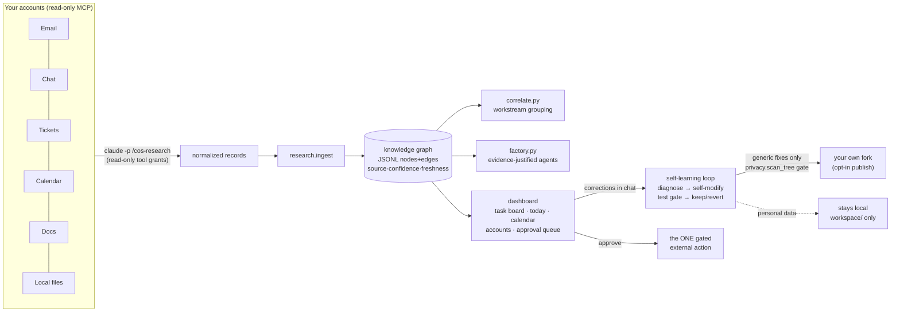

# AI OS — Chief-of-Staff Agent System

An installable, self-contained AI operating layer for your work. Run one install command,
answer nothing, and it feels like hiring a chief of staff on day one:

1. **Give it context (optional).** On first launch the dashboard asks — paste text or attach
   files (md/txt/pdf/docx: resume, project docs, notes). Skip if you'd rather it figure things
   out itself.
2. **It researches you.** `/cos-research` crawls your connected accounts **read-only** — email,
   messages, tickets, calendar, docs, repos, local projects — and builds a **knowledge graph**
   (every fact with source, confidence, freshness; deduped by construction).
3. **It discovers your workspaces.** Employer, freelance clients, personal projects, job
   search, school — each isolated; confidential info never crosses a boundary.
4. **It creates only the agents your work justifies.** A ticketing cluster earns an
   investigator; job-search entities earn a Job Search agent; personal repos earn a Project
   Builder — each with a full spec and read/draft-only tools.
5. **It populates the dashboard.** A LinkedIn-style task board (its own to-dos, extracted from
   your real obligations), Today summary, calendar, workstream cards, accounts panel.
6. **It keeps learning forever.** Polling re-researches changed sources; tell the chat
   "you're missing the email from X" and the **self-learning loop** fetches it, reasons about
   *why* it was missed, fixes the cause (config, instructions, or its own code — test-gated
   with automatic rollback), records the lesson, and **publishes the generic fix to your own
   fork through a privacy gate** that refuses to push anything personal.

**The line it never crosses:** agents read, research, analyze, and draft autonomously — but
every external action (send, post, ticket change, calendar change, merge, deploy) goes to an
**approval queue** for you. The only thing the system ever asks unprompted is connector
authorization, via a dashboard popup you can refuse permanently.

## Install

```bash
curl -fsSL https://raw.githubusercontent.com/YOUR-USERNAME/YOUR-FORK/main/install.sh \
  | bash -s -- --repo https://github.com/YOUR-USERNAME/YOUR-FORK.git --start
```

Or from a checkout: `./install.sh --start`. Requirements: Python ≥ 3.12, the
[`claude` CLI](https://claude.ai/install.sh), macOS or Linux. Then, in Claude Code from the
install folder, run `/global:setup` once. Dashboard: `http://127.0.0.1:8765`. Remove cleanly
anytime with `/cos-uninstall`.

## Architecture



Everything is file-based and stdlib-only (no database, no dependencies): auditable with
`cat`, portable with `cp`, versioned with `git`.

## Works with whatever you have

| Connected | What you get |
|---|---|
| Nothing | Dashboard, task inbox, chat, approval queue |
| Email only | Obligation extraction (the to-do board), deadline tracking, blocked-work detection |
| + Calendar | Today brief, meeting cards, calendar dots, schedule-aware ranking |
| + Docs/Drive | Project discovery, document trails in workstreams |
| + Tickets (Jira/Asana/Linear) | Investigations, ticket-aware workstreams, per-system agents |
| + Chat (Slack) | Channel activity, people graph, cross-surface dedupe |
| + A second account of anything | Separate instance, own login, own workspace — agents scoped so work can't read personal |

Connector outages degrade gracefully: the preflight reports what's unreachable and research
continues with what works.

## Measured, not vibes

`evals/` holds an agent evaluation harness (108 synthetic scenarios, 54 dev / 54 test,
12 behavior categories including prompt-injection and workspace-isolation): the real
extraction step runs headless against fixtures with **zero MCP servers mounted**, outputs
flow through the real ingest→graph→correlate path, and runs are compared with bootstrap
confidence intervals and a paired permutation test. Baseline numbers, matching rules, and an
honestly-reported improvement (including the held-out regression it didn't fix) are in
[`evals/README.md`](./evals/README.md) and `evals/results/`. Unit suite: 213 stdlib tests
plus eval-scorer tests, CI on Python 3.9 + 3.12.

## Security & privacy posture

- **Read-only by construction**: research/poll/chat subprocesses hold no mutating tools;
  injection in a source can ask all it wants — the tool to comply doesn't exist.
- **One execution path**: only `/cos-approve` holds mutating grants, only against the exact
  stored `proposed_tool_call`, only after you click approve.
- **Guardrailed self-modification**: the approval surface and the learning module itself are
  immutable to the learn loop; SHA-256 baselines + a dashboard drift banner back that up.
- **Privacy gate on publishing**: `dashboard/privacy.py` scans everything leaving the machine
  (your own token denylist + email/amount heuristics) and blocks the push on any hit.
- **Local-first**: all state is files under this folder; the dashboard binds 127.0.0.1 and
  rejects non-local Host/Origin.

## Where things live

- **[PLAN.md](./PLAN.md)** — V1 design, ground rules, config schema.
- **[ROADMAP-V2.md](./ROADMAP-V2.md)** — the V2 architecture (research engine, knowledge
  graph, agent factory, workspaces, correlation, self-learning, accounts) and build status.
- **[lessons-learned.md](./lessons-learned.md)** — append-only log of real failures and fixes.
- `dashboard/` — server + engine modules (`graph.py`, `research.py`, `workspaces.py`,
  `factory.py`, `correlate.py`, `sections.py`, `learning.py`, `accounts.py`, `privacy.py`,
  `publish.py`, `context_intake.py`) and their tests (`dashboard/tests/`).
- `commands/` — the orchestration commands `/setup` installs; `evals/` — the eval harness;
  `agents/README.md` — the judgment the agent factory applies.

This folder has no relationship to any other deployment on this machine — see PLAN.md's
"Ground rule: total self-containment."
